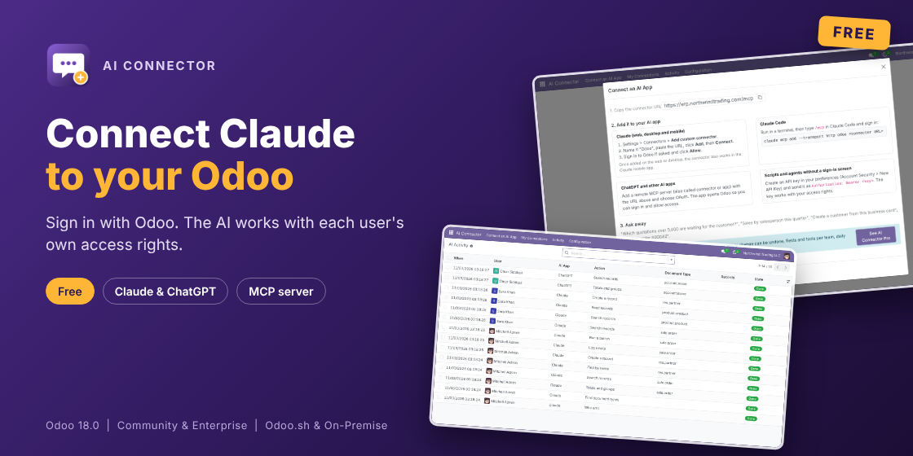

# AI Connector for Claude & MCP (Odoo 18.0)

Connect Claude, ChatGPT and other MCP apps to Odoo. Users sign in with Odoo and the AI works with exactly their own access rights.

- **Sign in with Odoo** (OAuth 2.1 with PKCE). AI apps register themselves; disconnect any app or user in one click.
- **13 tools**: find document types, describe fields, search, read, count, totals by group, find by name, create, update, run buttons (confirm, post...), log notes, delete (off by default). Switch each tool on or off.
- **Safe by design**: Odoo access rights and record rules apply, passwords and keys stay hidden, technical settings are off limits, every action is logged.
- **MCP**: Streamable HTTP, protocol 2026-07-28 and the earlier handshake (2025-11-25, 2025-06-18, 2025-03-26).

## Install

1. Copy `novator_mcp` into your addons path and install **AI Connector**.
2. Settings > AI Connector: choose who can connect.
3. AI Connector > Connect an AI App: copy the connector URL (`https://your-odoo/mcp`).
4. In Claude: Settings > Connectors > Add custom connector. Paste the URL, click Connect, sign in to Odoo and click Allow.

Your Odoo must be reachable over https. With several databases on one server, select the database by domain (`dbfilter`).

## More

- Odoo Apps Store: https://apps.odoo.com/apps/modules/18.0/novator_mcp
- Approvals, undo, team rules, daily limits and workflows: [AI Connector Pro](https://apps.odoo.com/apps/modules/18.0/novator_mcp_pro)
- Support: support@novator.co, https://www.novator.co

## License

GNU Affero General Public License v3 (AGPL-3). (c) Novator Technologies.
